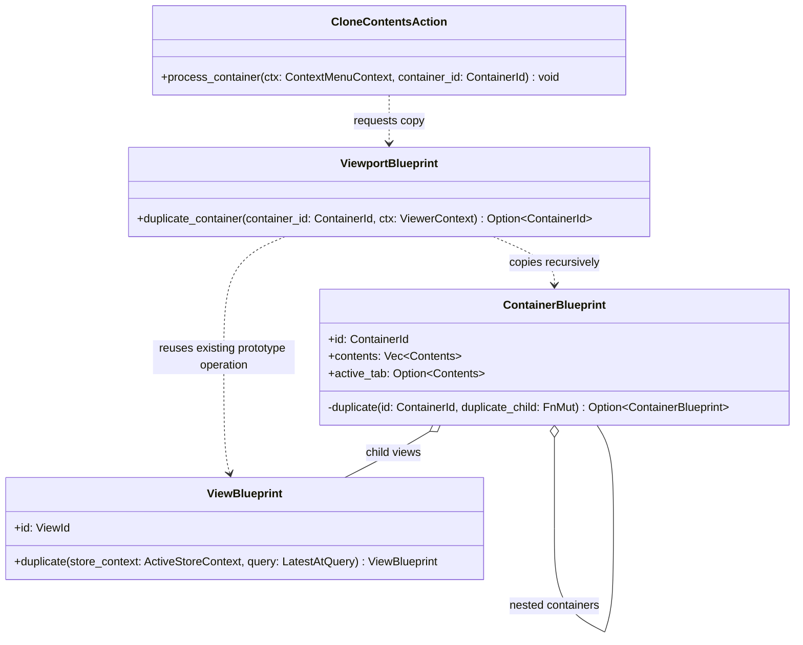
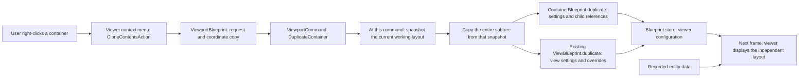

# Container cloning and the prototype pattern

This is the source documentation for assignment Parts 2 and 3 and issue #7923.
The complete assignment, including the separate GRASP refactoring and AI Use Log, is on the [Design Patterns wiki](https://github.com/donnyboy72/rerun/wiki/Design-Patterns).

## Part 2 a missing prototype for container hierarchies

**Selected issue:** [#7923: Add clone for view containers](https://github.com/rerun-io/rerun/issues/7923).
**Implementation branch:** `fix-7923-clone-view-containers`.
**Implementation commit:** `84b6da8994` — `A8: Apply Prototype to ContainerBlueprint` (local; the source branch has not been pushed).
This replaces the abandoned table-cell Strategy proposal; that implementation was reverted on `a8-design-patterns`.

### What problem exists today

A container arranges viewer panels into tabs, rows, columns, or a grid, and can contain other containers.
Rerun can clone one view, but its Clone menu action only accepts `Item::View`.
A user who wants another copy of a configured dashboard must recreate its nested containers manually.

`ContainerBlueprint` has Rust's ordinary `Clone`, but that keeps the same identifier and child references.
It does not create an independent dashboard.
A correct copy must allocate new identifiers, copy every descendant, and replace references such as the active tab with references to the copied children.
This missing operation concerns the viewer's configuration; it does not copy the recorded sensor data.

**Assignment limitation:** this extends a missing capability rather than removing a demonstrated long conditional or duplicated reconstruction code.
Prototype already exists for individual views; the missing application is an independent copy of a whole container hierarchy.
The assignment justification is the identity and reference problem above, not an invented claim that Rerun already duplicates container-copying code.

### The GoF pattern and design

**Prototype is a creational GoF pattern:** create a new object by copying an existing configured object instead of rebuilding its configuration from scratch.
Here the selected container is the prototype.
The result is a recursively copied container hierarchy whose views retain their settings but receive new identifiers.

The implemented responsibility split is:

- The context menu requests a copy and selects the result.
- `ViewportBlueprint` locates the hierarchy and coordinates insertion into the existing layout.
- `ContainerBlueprint` copies its settings and remaps its child references.
- The existing `ViewBlueprint::duplicate()` copies each view, including its stored properties and overrides.



These are the implemented class names; method argument types are abbreviated in the diagram.
The `id` parameter of `ContainerBlueprint::duplicate` is the new container identifier, and `duplicate_child` is a callback returning each independently copied child.
Rust structs represent classes; the copy operations are an idiomatic Prototype implementation without an artificial inheritance hierarchy.

### Connection to GRASP

**Information Expert:** the blueprint model has the information needed to copy layouts, settings, and references.
**Low Coupling and High Cohesion:** the context menu requests duplication rather than reconstructing every container and view property itself.
The proposal supplies this missing responsibility in the model and avoids introducing that construction knowledge into the UI.

## Part 3 implement container cloning

**Implemented and verified locally.**
Commit: `84b6da8994` — `A8: Apply Prototype to ContainerBlueprint`.
No PR was opened, and the source branch has not been pushed.
The original assignment branch `a8-design-patterns` remains available with the separate Part 4 commit.

### Before

The menu action explicitly accepted only views:

```rust
fn supports_item(&self, _ctx: &ContextMenuContext<'_>, item: &Item) -> bool {
    matches!(item, Item::View(_))
}
```

`ViewBlueprint::duplicate()` already created an independent copy of one view.
`ContainerBlueprint` only had Rust's ordinary `Clone`, which retains its identifier and child references.
There was no independent container-subtree duplication operation and no container Clone menu item.

### After

The renamed `CloneContentsAction` accepts both kinds of blueprint content:

```rust
fn supports_item(&self, _ctx: &ContextMenuContext<'_>, item: &Item) -> bool {
    matches!(item, Item::View(_) | Item::Container(_))
}
```

Its container handler asks the model for the copy and selects the new container:

```rust
fn process_container(&self, ctx: &ContextMenuContext<'_>, container_id: &ContainerId) {
    if let Some(new_id) = ctx
        .viewport_blueprint
        .duplicate_container(container_id, ctx.viewer_context)
    {
        ctx.viewer_context
            .command_sender()
            .send_system(SystemCommand::set_selection(Item::Container(new_id)));
    }
}
```

The concrete Prototype operation is a private helper owned by `ContainerBlueprint`:
Only `ViewportBlueprint::duplicate_container()` is exposed to the context-menu crate.

```rust
fn duplicate(
    &self,
    id: ContainerId,
    mut duplicate_child: impl FnMut(Contents) -> Option<Contents>,
) -> Option<Self> {
    let contents = self
        .contents
        .iter()
        .copied()
        .map(&mut duplicate_child)
        .collect::<Option<Vec<_>>>()?;
    let active_tab = self.active_tab.and_then(|active| {
        self.contents
            .iter()
            .position(|child| *child == active)
            .map(|index| contents[index])
    });

    Some(Self {
        id,
        contents,
        active_tab,
        ..self.clone()
    })
}
```

In plain language: copy the settings, replace every child with its own copy, and point the active tab at the corresponding copied child.
`ViewportBlueprint::duplicate_container_tree()` supplies the recursive callback: containers repeat this operation, while views reuse `ViewBlueprint::duplicate()` to retain their stored properties and entity overrides.

Before traversing the hierarchy, the command snapshots the current working layout with `ContainerBlueprint::from_egui_tiles_container()`.
Saving and cloning share the same internal tile-to-blueprint mapping, including newly added containers and temporary single-view tab wrappers.
Names are retained from the stored container model; layout kind, children, proportions, visibility, and active tabs come from the current tree.
The whole subtree is constructed before insertion, so a missing descendant does not leave a partly inserted copy.
Insertion is queued as `ViewportCommand::DuplicateContainer` and applied at the end of the frame, matching Rerun's existing layout-edit workflow.
A normal copy is placed immediately after the original in the same parent.
Copying the root creates a new tab container holding the original and its copy.
The copy is activated when necessary so it is visible inside a tab parent.

### Review follow-up: command ordering and helper visibility

The original implementation commit is `84b6da8994`.
The separate local review follow-up fixes command ordering and broadens regression coverage; neither source commit has been pushed.

**Rule:** Clone includes earlier layout commands in the same queue and excludes later commands.
For example, changing a dashboard from Grid to Horizontal and then cloning it produces a Horizontal copy.
Cloning it first and then changing the original to Horizontal leaves the copy as Grid.

A regression test reproduced the original defect before the fix: the original became Horizontal, but its copy stayed Grid.
The cause was two representations of the layout: earlier commands updated the working tree, while cloning still read the older container map.
The fix builds an in-memory snapshot from the working tree when the Clone command executes, without saving or reloading the database midway through processing.
Recursive copying then uses that snapshot.

The container-level `duplicate()` helper is now private because it only serves this implementation.
The menu-facing `ViewportBlueprint::duplicate_container()` remains public.
This changes visibility, not the Prototype responsibilities or normal menu behavior.

### Where the change sits in the program



This code runs in the Rust viewer, not in the SDK.
The blueprint store holds display instructions; the recording supplies the data those views display.
Copying a layout does not duplicate recorded data or automatically change entity paths.

### Before and after example

```text
Before:                         After cloning Robot dashboard:
Workspace                       Workspace
  Robot dashboard                 Robot dashboard
    Robot positions                 Robot positions
    Notes tabs                      Notes tabs
      Setup                           Setup
      Checklist                       Checklist
  Walkthrough                     COPY dashboard
                                    COPY positions
                                    Notes tabs
                                      Setup
                                      Checklist
                                  Walkthrough
```

The `COPY` names were edited after cloning in the recording to demonstrate independence.
The original names stayed unchanged.
The copied Notes tabs retained the same initially active Checklist tab.

### Before and after viewer recordings

These are actual captures of the source-built viewer, sampled at two frames per second, using the same `container_clone.rrd` file.
They are silent screen recordings, not a simulated animation.
Brief pauses are included to make the menus and names readable.
The unchanged viewer was built before enabling the new code; both versions were built with `cargo build -p re_viewer --bin viewer --no-default-features`.

**Before, 13 seconds:** the container menu has no Clone item; the individual view menu does.


[Open or download the before video](https://raw.githubusercontent.com/wiki/donnyboy72/rerun/assets/container-clone-before.mp4).

**After, 23 seconds:** clone the dashboard, observe the nested copy, rename its container and one view, and select the original to show its names are unchanged.


[Open or download the after video](https://raw.githubusercontent.com/wiki/donnyboy72/rerun/assets/container-clone-after.mp4).

The reproducible demo source and full-resolution captures are saved in the course workspace under `rerun_demos/container_clone_7923/`.
Diagram source is committed under `/docs` in the implementation repository.

### What is easier to change

**Container-copying rules can now change inside the blueprint model without teaching the context menu how to reconstruct layouts, nested containers, or view settings.**
Users can also reuse a configured dashboard without manually rebuilding its hierarchy.

### Validation

- All 21 tests passed across `re_viewport_blueprint` and `re_context_menu`, using `cargo nextest run --all-features --no-fail-fast`.
- Twelve cloning regression tests now cover the original four scenarios plus eight review-follow-up scenarios: queue order, moved children, sizing and tab changes, newly added views and containers, every parent layout, independent view overrides, and replaced trees with temporary tabs.
- The nested test checks all four container kinds, an empty hidden container, fresh identifiers, names, visibility, row and column shares, grid column count, remapped active tabs, view origins, entity filters, title-bar settings, and copied stored entity overrides.
- A persisted rename and visibility change on the copied container leaves the original unchanged.
- Changing a copied view's stored visibility override, then saving and reloading, leaves the original override unchanged.
- Insertion between siblings is tested in Tabs, Horizontal, Vertical, and Grid parents, preserving unaffected siblings' order and applicable sizing settings.
- The stale-layout regression failed before the fix and passes afterward.
- Clippy passed for both affected crates with all targets and features, without warnings.
- Rust formatting passed, and the modified development viewer built successfully.
- Manual viewer verification confirmed the new menu action, copied nested tabs, independent container and view names, and the unchanged original.
- The rebuilt review-follow-up viewer was checked again on October 18: nested cloning and independent container renaming still work.
  The original before/after videos are retained as evidence of the unchanged normal behavior.
- The complete final fast-lint run passed, covering code generation, repository conventions, Rust formatting, Python formatting and typing, spelling, file sizes, and notebook cleanliness.
  Final lint review corrected the new test's iterator style and a short-hash spelling false positive; the file-size check also passed after staging the renamed source file.

**Limits:** this is a development viewer build and focused regression testing, not a claim that every platform and the entire repository test suite were tested.
Maintainers have not reviewed or accepted this change.
